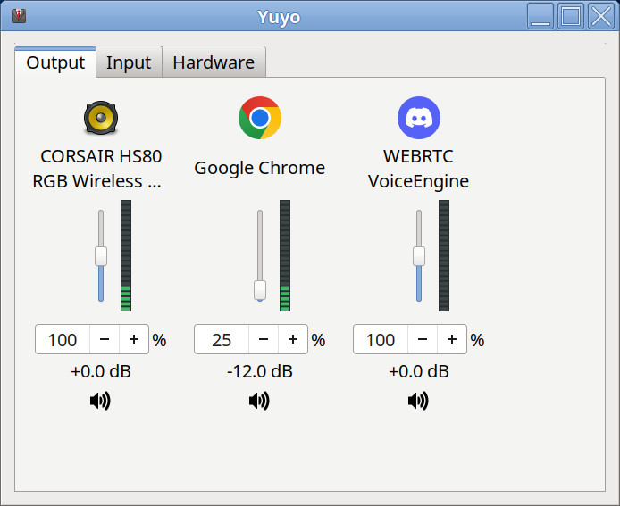
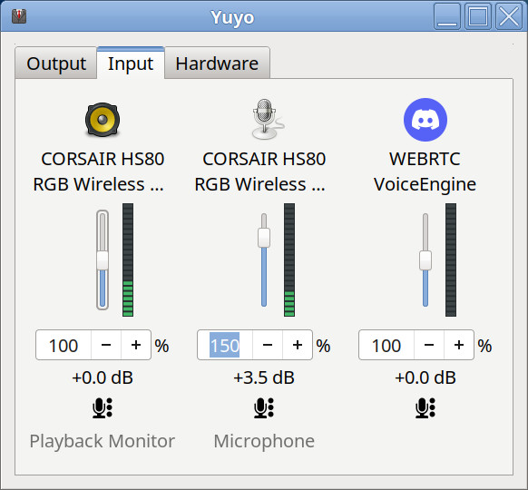
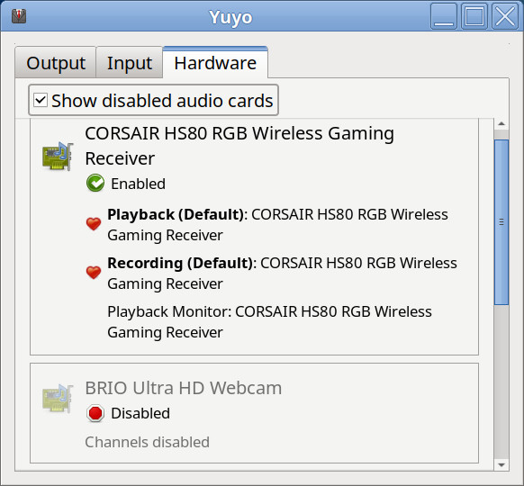

# Yuyo

A lightweight audio mixer for Linux MATE.

Yuyo is a GTK3 audio mixer for PipeWire and PulseAudio with dedicated **Output**, **Input**, and **Hardware** tabs.

## Features

- Vertical volume sliders, mute controls, and live audio level meters
- Playback and recording device selection
- Hardware card status and available audio profiles
- Detects audio device changes
- System tray icon with volume controls
- Theme-aware icons

## Screenshots

### Output


### Input


### Hardware


## Requirements

- Python 3
- GTK 3 and PyGObject (`python3-gobject`)
- PulseAudio utilities (`pactl` and `parec`)
- PipeWire with PulseAudio compatibility, or PulseAudio
- Linux desktop with a system tray, designed for MATE

## Run from source on Fedora

Download Yuyo and install the dependencies:

```bash
sudo dnf install python3-gobject gtk3 pulseaudio-utils
curl -fLO https://raw.githubusercontent.com/solo2101/Yuyo/main/yuyo.py
python3 yuyo.py
```

This opens the mixer window. To launch directly into the system tray, use `python3 yuyo.py --tray`.

Closing the mixer window keeps Yuyo running in the system tray. Select **Quit** from the tray menu to exit. Running from source does not configure automatic startup.

## Build an RPM on Fedora

Install the RPM build tools:

```bash
sudo dnf install rpm-build rpmdevtools
rpmdev-setuptree
```

Download the source and RPM spec:

```bash
curl -fL https://raw.githubusercontent.com/solo2101/Yuyo/main/yuyo.py -o ~/rpmbuild/SOURCES/yuyo.py
curl -fL https://raw.githubusercontent.com/solo2101/Yuyo/main/packaging/yuyo.spec -o ~/rpmbuild/SPECS/yuyo.spec
```

Build and install:

```bash
rpmbuild -bb ~/rpmbuild/SPECS/yuyo.spec
sudo dnf install ~/rpmbuild/RPMS/noarch/yuyo-1.0.0-3.*.noarch.rpm
```

The Fedora release suffix in the RPM filename depends on the build system. The RPM is built locally from source; this repository does not currently provide a downloadable RPM release.

The RPM installs a system-wide MATE autostart entry. Yuyo launches hidden in the system tray at the next MATE login, without opening the mixer window. Click the tray icon to open the mixer. You can also start it hidden with `yuyo --tray`. To disable autostart for your account, use MATE Startup Applications.

For an existing RPM installation, the same `dnf install` command upgrades to release 1.0.0-3.

## Version

Application version: **1.0.0**. RPM package release: **1.0.0-3**. The third RPM revision adds automatic, hidden system-tray startup for MATE.

## License

GNU General Public License v3.0 only. See [LICENSE](LICENSE).
